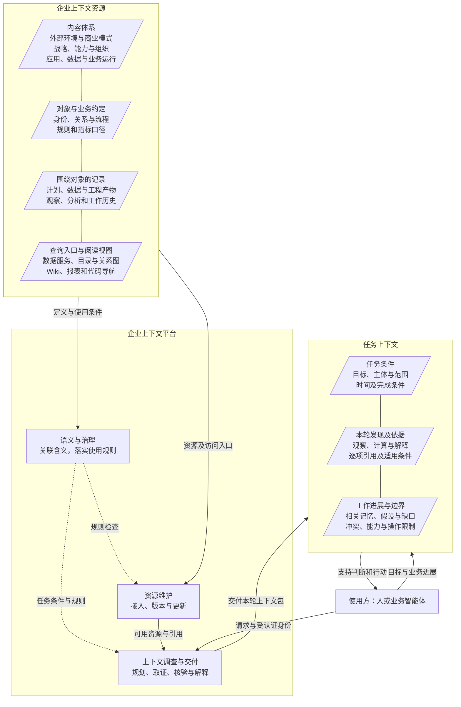
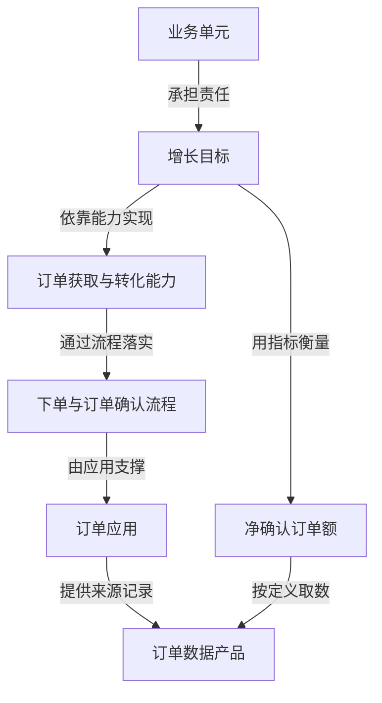
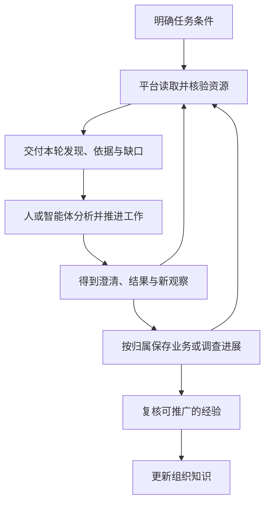

# 第 3 章 企业上下文怎样组织起来

> 本章要回答：企业上下文资源、任务上下文和平台各自包含什么，三者怎样协作支持一项工作？

第一章给出三个核心部分的关系。本章展开每个部分，再用建设、调查和维护三条流程说明它们怎样协作。退款贯穿资源与交付，销售分析和软硬件设计则说明同一架构怎样支持不同工作。

## 3.1 三个部分的内部组成

斜框表示信息，平台内部的矩形表示能力，使用方表示参与者。资源内部的无向线表示联系：内容范围、对象定义、具体记录和访问视图共同说明一批资源，不能把它们读成四个必须依次经过的数据库。所有定义、记录和视图都带有来源、版本及使用条件。任务上下文由本轮调查交付与使用方的目标、业务进展共同形成。

同一份指标定义可以长期保存在资源中，被多个任务引用。销售分析只取其中适用的版本，再加上此次比较的期间、组织范围、经营观察和核验进展，形成当前任务上下文。用户的目标和身份来自本次请求，不能仅从历史资源推断。

这张图说明职责和信息之间的关系。3.5节再展开过程：谁建设资源，谁调查问题，谁根据交付继续工作，以及变化怎样反馈到资源维护。

## 3.2 企业上下文资源怎样组织

组织资源时，可以先看一份预算：它属于哪项经营安排，分配给哪个团队和项目，金额是申请值还是批准值，在哪个系统查询，哪个版本仍然有效？同一份材料需要同时回答这些问题，才能被正确使用。

下面依次说明企业内容范围、对象与业务约定、具体记录、查询与阅读方式，以及贯穿其中的来源和使用条件。这样，无论任务从战略目标、业务流程还是一次告警进入，都能沿共同身份找到相关材料。

### 3.2.1 内容体系：覆盖企业的哪些方面

第一章的内容体系覆盖从商业模式到业务运行的企业全貌。在资源中，每一方面都需要落实为可以识别的对象，以及有业务含义的联系。

| 企业内容 | 需要认识的业务对象 | 需要建立的联系 |
|---|---|---|
| 外部环境与商业模式 | 客户群、市场、产品、收入来源、外部约束 | 为谁提供什么价值，哪些收入与约束影响经营选择 |
| 战略目标与经营安排 | 目标、举措、指标、预算、计划、决策原则 | 怎样衡量结果，怎样分配投入，为什么作出取舍 |
| 业务能力、产品与流程 | 能力、价值流、产品、服务、流程、规则 | 提供什么，工作怎样衔接，适用什么条件及例外 |
| 组织、责任与资源 | 业务单元、团队、角色、人员、设备、资金 | 谁负责和决定，资源由谁使用和维护 |
| 应用、数据与技术基础 | 应用、服务、代码、数据、事件契约、部署实例 | 业务怎样由技术实现，数据是什么意思，到哪里取证 |
| 运行状态与工作历史 | 订单实例、观察、事故、决策、行动与结果 | 何时何地发生什么，查过什么，如何处理，结果怎样 |

围绕这些对象，还要保留描述它们的材料。例如，指标有计算定义及不同期间的数值，应用有设计说明及运行观察，退款有适用政策及处理记录。这些材料通过对象身份和版本联系起来，供任务查询与核验。

内容归属取决于材料在说明什么。一份退款 Runbook 可能同时说明业务条件、部署对象和故障处置方法，所以可以连接多个方面。流程定义放在业务能力、产品与流程中；某次流程运行的状态和处理结果，放在运行状态与工作历史中。应用的部署设计与某台实例的当前告警也作类似区分。这样查资料时，既能找到工作方法，也能看见实际情况。

### 3.2.2 对象与业务约定：说清含义、联系和变化

对象让分散的资料有共同的指向。退款政策、退款申请和退款服务各有身份，资料中的不同名称可以映射到对应对象。业务约定进一步说明对象的属性、关系、变化方式和使用规则。本体与领域模型帮助把这些含义明确写下来，供不同系统共同使用。

例如，企业提出一个增长目标，就需要说明衡量它的指标、承担目标的业务单元，以及准备改善的业务能力。沿着能力可以找到相关流程，再找到支撑流程的应用和数据。沿着指标可以找到定义与数据来源，核对实际表现。这些联系让经营问题能够落到可检查的事实，也让一次运行异常能够追溯到业务影响。

下面用销售分析展示一组资源中的对象关系。每个框表示一个业务对象，箭头表示它们在业务上的联系。

这组关系提供了多条查证路径：从目标找到指标，可以核对经营结果；从责任关系找到业务单元，可以确认解释和决策由谁负责；沿能力、流程和应用继续查，可以定位相关运行记录。关系本身也需要依据，例如“业务单元承担目标”来自目标责任文件，“指标使用数据产品”来自指标定义及数据目录。

以“净确认订单额下降”为例，平台沿这些关系找到指标定义与所属目标，再确认涉及的业务单元、产品和渠道，以及提供订单数据的数据服务。随后取得同一口径下的两个期间快照。若要调查某次流程调整是否影响了销售，还需继续查调整时间、受影响订单和对照证据。架构关系指明查证方向，调查所得的证据决定能得出什么结论。

业务约定也包括流程。围绕退款申请，可以描述“提交后核对政策，符合条件时请求退款，不符合时转人工，收到支付结果后继续处理”。当模型中的事件、规则和动作把顺序、分支、等待及失败处理交代清楚时，它们就表达了一套流程。流程定义可以与对象定义共同维护；需要图形交流时，再按这些定义画出流程图。实际执行则由工作流或业务系统负责，第八章会展开这些约定怎样建立。

指标定义是另一组业务约定。例如，“净确认订单额”需要说明哪些订单计入、折扣和退货怎样扣除、使用什么币种、按什么期间统计，以及数据从哪里取得。计算公式只是其中一部分，记录粒度和允许的汇总方式也会影响结果。这些定义可以纳入企业模型，也可以由专门的指标系统维护，再通过指标身份连接起来。

定义也要保存成可管理的材料，例如带版本的模型文件、规则表或指标目录。模型中的“服务部署到实例”规定关系的含义；具体哪个服务部署到哪个实例，还要由相应记录及其依据来说明。

### 3.2.3 具体记录：保留意图、实现、观察与工作经过

有了对象和定义，还需要接入企业实际保存的记录。目标与预算说明准备做什么，订单和会计记录说明业务系统记下了什么，代码和设计文件保留工作产物，运行观察说明某时某地测到了什么，分析与任务记录保留判断及工作经过。它们共同提供任务所需的依据。

还要留下“为什么这样做”。例如，退款采用异步处理，可能是为了隔离支付方故障；某个审批步骤可能源于当时的风险约束。这些理由会影响后续取舍，应关联到决策记录、责任人和适用条件。找不到当初理由时，可以访谈并形成待核对记录，不能根据现有代码反推一个动机，再把它写成企业已经确认的事实。

以同一个销售指标为例，下面几份记录承担不同作用：

| 围绕指标保存的记录 | 说明什么 | 需要一同保留的条件 |
|---|---|---|
| 指标定义 | 怎样理解和计算净确认订单额 | 定义版本、单位、期间口径、数据来源与维护者 |
| 目标记录 | 指定组织在 H2 希望达到多少 | 目标值、适用范围、计划版本与批准依据 |
| 预测记录 | 在给定假设下，预计 H2 达到多少 | 假设、方法、输入快照和生成时间 |
| 实际值记录 | 按指定口径汇总后，H2 得到多少 | 指标定义版本、期间、分组条件、来源快照与计算依据 |
| 分析和工作记录 | 查过什么，如何解释，还缺什么 | 所属任务、使用的证据、结论或假设、待办与复核情况 |

目标值属于经营安排。进一步规定“实际值低于目标多少时通知谁”，才形成相应的判断和动作规则。目标、预测和实际值可以共用一个指标定义，但各自保留身份与版本，才能比较偏差并解释变化。

企业数据远不止汇总指标。订单明细、会计分录、人员与设备台账、库存、监控读数和流程事件，都可以通过对象身份接入资源体系。平台需要知道一条记录代表什么、哪些字段可以关联、数值怎样使用。例如，期间销售额与期末库存分别描述一段时间的业务量和某个时点的存量；汇总时要采用各自的规则。

这些记录的性质要在使用时保留下来。架构设计可能说明未来安排，也可能记录现状；某版代码包含发送消息的路径，说明该实现存在；部署配置说明某个环境怎样设置；运行日志提供特定时段实际发生过什么的证据。代码分支是否启用、日志是否完整，都还要核对。一份材料中可以同时存在要求、现状描述和推测，需要分别说明依据。

前面提到的知识、观测和记忆，可以从使用角度理解：定义、政策和手册提供可复用知识；业务记录与观测为判断实际情况提供证据；任务记忆保存某次工作中已经确认、尝试和待办的事项。预测仍带着假设，分析仍需证据核验。它们通过同一对象身份相接，各自保留原来的性质。

### 3.2.4 查询与阅读：让任务取得并理解资源

定义和记录可以继续保存在企业已有系统中。订单留在业务数据库，经营明细留在数据仓库，代码留在版本库，监控读数留在时序系统。平台登记来源、对象映射、字段含义、权限和查询入口，收到任务后取得必要的记录或快照。数据目录帮助找到数据，受控查询入口负责实际取数。

对于需要频繁跨资料查找的对象和关系，可以用知识图谱组织起来。例如，把增长目标、负责团队、销售指标与数据产品相连，让任务沿这些联系找到依据。图谱可以同时保存模型定义、具体对象和相关声明，也可以保留指向源系统的引用。业务明细仍可由原系统按需提供。

在这些资源之上，按使用目的组织不同视图：关系图突出对象联系，流程图突出步骤与分支，报表突出数值及其比较，Wiki 连贯解释一个主题，代码导航定位实现和测试。这里的视图是为某种查询或阅读目的选出的内容；同一批资源可以生成多种视图。

视图要保留原有内容的性质。例如，架构对照图可以同时展示计划部署、现有配置和运行观察，但必须标明各自依据；销售报表可以同时展示目标、预测和实际值，但要区分数值类别与版本。把某项描述画成图或写入 Wiki，并不会提高它的证据强度。

对象关系可以像目录一样帮助找资料，也可以直接回答有明确依据的问题，例如“这个服务由谁负责”。需要核对例外条款或设计理由时，再读对应原文。图中的声明与它的来源共同构成一条证据链，不能因为同一说法同时出现在图和Wiki里，就算作两份独立佐证。

企业也会直接在 Wiki 中维护正式政策和操作手册。这时页面本身是受管理的来源。由平台汇编生成的业务介绍则是派生视图，需要指回输入材料。一份 Runbook 可以同时进入多种表示：步骤用于说明流程，提到的服务用于关系导航，完整正文供人阅读。

用这条思路回看企业的六方面内容，可以逐项检查是否有定义、记录和取得材料的入口：

| 企业内容 | 可以接入的具体资源 | 任务怎样使用 |
|---|---|---|
| 外部环境与商业模式 | 客户群定义、市场调查、合同与商业计划 | 对照价值主张、客户证据及外部约束，阅读时区分假设与调查结果 |
| 战略目标与经营安排 | 目标、指标定义、预算、预测及实际经营数据 | 沿目标找口径与数据入口，查询报表，再追到批准记录和来源明细 |
| 业务能力、产品与流程 | 能力与流程定义、产品要求、政策、业务实例及处理事件 | 阅读业务说明，沿流程查规则，再核对某次业务实际经过的步骤 |
| 组织、责任与资源 | 组织职责、人员任职、设备台账、资金分配记录 | 从团队或项目找到责任人和资源，并核对适用时间 |
| 应用、数据与技术基础 | 架构设计、应用与数据目录、代码、配置、构建和部署记录 | 比较设计与实现，导航到代码，查询对应环境的部署信息 |
| 运行状态与工作历史 | 状态记录、监控读数、事故、决策、行动回执及任务记录 | 读取当前情况，追查历史处理和结果，接续尚未完成的工作 |

建设时可以从一项任务所需的资源开始，逐步复用已有对象身份，扩展跨部门联系。第四章讲资料接入，第五、六章讲检索和关系查证，第七章讲阅读视图，第八章讲业务建模，第九章讲怎样为具体任务取材。

### 3.2.5 来源与使用条件：判断本次能否采用

每份定义、记录和视图都需要说明来源、版本、适用时间、责任人及访问条件。金额还要有单位和口径，观察还要有环境和采样时间，预测还要有假设，任务记录还要有归属和保留范围。平台据此判断当前任务是否可以使用这些材料。

来源及陈述性质应细到足以支持核验。一张关系图里的不同边，可能分别来自政策、代码解析和运行观察；每条边都需要保留自己的依据。若目标架构与当前部署不同，应保留两者的时间、范围和差异，让任务继续调查。

业务对象与关于它的记录分别保留身份。指标可以长期存在，定义会更新，各期间数值和分析记录则引用当时的定义及来源快照。更正数据或变更口径时，系统能够找到受影响的报表、摘要和任务材料，重算或标明失效，并保留解释历史结果所需的版本。

模型本身也按同样方式维护。财务客户与客服联系人可以保留各自定义，再说明映射条件。业务负责人确认含义，平台按已发布定义关联资源；第十一、十二章分别展开版本维护与访问控制。

## 3.3 任务上下文怎样组成

资源面向企业中可能发生的多项工作，任务上下文面向当前这项工作的一个决策点。它由本次请求、所选企业资源和任务已经产生的进展共同组成。

### 3.3.1 任务条件：明确这次要做什么

任务条件包含目标、主体、范围、时间和完成标准。销售分析需要明确指标与比较期间，退款处置需要明确是判断原因还是实施处理。允许的行动和预算也随任务确定。已确认条件应被后续步骤沿用，修改条件时要重新检查受影响的材料。

第一章的四类问题有助于确定完成标准：认知任务检查解释与证据，决策任务检查选项、取舍及决定，创造任务检查新成果是否满足要求，执行任务检查业务结果是否达到。一个复合任务应分别记录这些结果，避免把分析完成当作决定已经作出，或把方案写好当作实施已经完成。

### 3.3.2 本轮发现及依据：查明了什么

本轮交付先说明查明了什么，再说明依据。观察可以写成“某时刻队列深度是多少”；计算结果可以写成“同口径H2比H1下降多少”；综合判断要说明它连接了哪些证据，假设则标明还要如何验证。每项关键发现都应能回到来源，而不只是包末尾附一串链接。

本次依据包括适用的定义和规则、相关对象与关系、业务观察和历史证据。每项材料保留来源、版本、范围与使用理由。用户应能知道：政策来自哪一版，数值按什么口径取得，关系由什么证据支持，观察在什么时间采集。

任务上下文既可以包含短材料，也可以保留外部引用，按需继续读取。选中的材料要足以支持当前判断，尤其不能在压缩时丢掉关键条件、单位和例外。

### 3.3.3 工作进展：保留已经知道和仍不知道的事

工作进展说明查过什么、采取过什么步骤、得到了什么结果，以及还有哪些待办。相关记忆帮助任务继续推进，已确认事实、待验证假设和用户声明则分别标明。

冲突与缺口也是上下文的一部分。例如两个报表口径不一致、当前库存没有取得、某个渠道变化尚无对照证据，都应该保留其影响与下一步需求。材料不足时，使用者才能决定补充查询、向人确认或停止相应判断。

### 3.3.4 能力与限制：说明现在可以怎样使用材料

上下文还应说明当前可用的读取能力、可以提出的操作及其限制。能力说明帮助智能体规划下一步，实际执行由相应服务检查权限、参数、前置状态和必要批准。关于工具的说明、工具执行结果与历史使用经验承担不同用途。

| 销售分析中的内容 | 在任务上下文中的作用 |
|---|---|
| 确认采用净确认订单额、H1/H2 和指定组织范围 | 任务条件 |
| 指标定义、目标与组织关系 | 所选知识与结构依据 |
| 按相同口径取得的两个期间快照 | 业务观测 |
| 已核对币种与取消订单的处理方式 | 工作进展 |
| 渠道变化可能有关，但缺少联合明细 | 假设与缺口 |
| 可读取经营数据，经营变更需要另行授权 | 能力与操作限制 |

### 3.3.5 任务推进时，上下文怎样变化

新的澄清、观察或分析结果会改变当前材料。平台重新核验影响范围，保留需要延续的进展，再准备下一轮上下文。长期任务可以维护外部工作档案，每次模型调用只读取其中适用的一部分。

恢复任务时，已有记录说明过去做到了哪里，当前权限和业务观察说明现在还能怎样继续。任务结束后，相关记录按保留要求归档或删除；有复用价值的经验经过复核，才进入组织知识。

## 3.4 平台怎样提供这三类能力

平台长期维护资源，并为具体任务提供上下文。其职责可以归为资源维护、语义与治理、上下文构造。下面说明每项能力的输入、输出和责任。

| 平台职责 | 接收什么 | 提供什么 |
|---|---|---|
| 资源维护 | 来源内容、访问入口、来源变化与必要任务进展 | 可访问资源、身份与版本、引用及更新记录 |
| 语义与治理 | 对象定义、身份映射、责任和有效策略 | 可采用的含义及访问、使用、更新规则 |
| 上下文构造 | 任务要求、受认证身份、可用资源与适用规则 | 本次条件、所选依据、进展、限制和缺口 |

### 3.4.1 资源维护

资源维护负责接入来源、记录身份、保留版本并处理变化。它可以保存一份文档，也可以登记一个受控查询入口。政策、数据服务和任务记录可以继续分布在原系统中，平台维护它们的引用和访问约定。

来源变化后，平台识别受影响的摘要、关系与引用，更新或标明失效。任务记录写入时检查归属、权限和保留要求；经验发布为组织知识时另行复核适用条件和依据。

### 3.4.2 语义与治理

语义能力让不同系统中的材料能够被正确关联，例如辨认某个服务的多个名字，或区分净订单额与收入。治理能力落实谁能使用、哪个版本适用、谁负责更新，以及冲突由谁处理。

一份权限手册可以作为解释材料，实际授权由当前生效的策略机制决定。过去可读的材料不一定今天仍可读，经过摘要的内容也要继续遵守来源的访问条件。

### 3.4.3 上下文构造

上下文构造根据当前任务选择读取路径：查找文档、查询结构化数据、沿关系取证、读取当前观察或相关记忆。材料回来后，检查权限、时间、口径、来源及冲突，再按任务需要组织输出。

这项能力还负责如实表达覆盖范围。缺少当前观察时不能用旧记录补成当前事实，未验证的解释不能进入已确认结论。查询预算不足时，可以缩小范围、分步读取或返回缺口。

### 3.4.4 平台内部的智能体怎样参与工作

外部智能体使用上下文完成业务工作，平台内部的智能体帮助建设资源、调查问题和维护任务上下文。内部助手也可以解释销售变化：核对指标，计算差异，检验候选解释，再交付有依据的判断和缺口。外部智能体结合业务目标继续比较方案、协调人员或准备行动。两者按委托范围分工，并不是一个只能找材料、另一个才可以推理。

这些智能能力贯穿三个部分，但各自承担的工作不同：

| 围绕哪一部分工作 | 智能体可以帮助做什么 | 怎样检查结果 |
|---|---|---|
| 企业上下文资源 | 理解原文，提出对象、关系和本体修订，整理视图，发现失效材料 | 保留原文及版本，核对候选含义和依据，再决定是否发布 |
| 企业上下文平台 | 选择取证路线，按结果补查，安排更新步骤，解释冲突 | 实际读取和写入仍经过接口的权限、版本、预算和状态检查 |
| 任务上下文 | 澄清目标，组织材料，记录已查事项和缺口，准备下一轮上下文 | 区分已确认条件、模型建议与业务观察，保留本次请求和来源 |

智能体也需要上下文才能开始工作。平台先提供当前身份可见的资源目录、术语和工具说明，再按需要读取具体材料。它不必先拿到全企业正文，维护资料的身份也不能自动成为查询用户的身份。

有些工作只需调用一次模型，例如给文档提出分类候选；另一些工作需要反复查看结果、选择工具和补查，更适合由智能体推进。两者可以使用同一个平台。平台保留这些工作的进展与检查记录，人员负责确认重要含义、任务意图和发布决定。

一次上下文请求也有自己的完成条件。交付口径一致的数据和待验证解释，可能完成了一次取证请求；是否已经解释清楚销售下降，则仍由业务任务的负责人判断。第八章展开辅助建模，第九章说明澄清与查询方法，第十章说明怎样把智能步骤接入平台。

## 3.5 沿建设、调查和维护走过一遍

### 3.5.1 建设：把原始资料变成可用资源

先登记来源和访问条件，解析文档、表格、代码与事件，再核对它们的业务含义。解析器可以识别表格列名，却不知道“到账”究竟指支付方受理还是客户账户入账。这类含义由业务人员确认，助手可以整理候选和问题。已确认的对象、关系和来源映射交给程序校验，随后发布可查询资源、阅读视图和数据入口。

已有数仓、术语表或指标服务可以直接成为来源。平台要补齐它们与企业对象、权限和任务的联系，而不是把所有记录重新抄进一套文本知识库。

### 3.5.2 调查：从问题到有依据的交付

任务开始时，用户与系统先明确要求及身份。平台据此读取资源，构造任务上下文。人或智能体使用材料形成判断，提出补充问题或受控动作。得到的新信息回到平台，形成下一轮材料和必要记录。

准备材料与改变业务状态由不同机制负责。智能体可以依据运行手册提出重放建议，执行服务仍要检查主体、参数、批准和当前状态；操作后还需要新的业务观察判断目标是否达到。关于这些机制的方法和实现分别在第 9、10、12 章展开。

一次任务没有执行外部动作，也会产生有用进展。例如销售口径得到确认、一个假设被排除，或缺少的数据有了明确负责人，都可以帮助后续工作。业务进展由业务流程或使用方维护，本次查询的步骤、预算和失败由平台维护；获授权的共享任务服务也可以保存两者，但要区分归属。

### 3.5.3 维护：变化发生后，重新检查受影响的内容

一份退款政策被修改，平台沿来源依赖找到引用它的关系、Wiki和上下文包，重建能够自动生成的部分，提醒负责人复核需要业务判断的部分。过去使用的政策版本仍可用于解释历史结果；今天的调查选择当前适用的版本。

目标到期、理由失效和相互矛盾的材料也会触发复核。平台可以发现“该重新看一看了”，新的战略目标和业务规则仍由有权负责人决定。

## 3.6 从分析到创造：两项任务的过程

### 3.6.1 销售分析：形成有依据的解释

现在用第一章提出的销售问题检验整套逻辑。以下是解释架构的场景；第四部分的教学案例只实现其中的最小切片，尚不具备通用自然语言分析或真实数据仓连接能力。

经营负责人问：“H2 的销售情况为什么比 H1 差这么多？”平台先把它识别为需要确认口径的分析任务。用户确认采用净确认订单额、自然年半年度和全公司范围后，才继续准备材料。若问题实际只问某个区域，全公司的确认就不能替代区域范围。

语义模型把这个指标与目标、业务单元、产品、渠道及数据产品关联起来。指标定义是可复用知识，按定义读取的 H1/H2 快照是观测，“这次已核对币种和取消订单处理方式”是任务记忆。它们通过同一指标身份与版本相接，而不是通过文字相似就认定相同。

平台先验证数据可比，再由确定性计算得到差异和分解，将计算依据、范围、来源和缺口交付给 Agent。某条渠道事件可以成为待调查线索，但如果没有订单级数据或对照证据，就不能写成已确认原因。同一批订单按产品和地区分别分组，也不能把两组差异重复相加。

Agent 可以据此解释已经确认的下降、提出后续核验事项，并指出需要哪位负责人补充信息。即使经营负责人级别很高，这次只读分析也不会自动获得调价工具。若以后决定实施经营变更，那是具有新目标、参数与批准要求的行动任务。

将这个过程与本章的架构对应起来：

| 场景中的材料或动作 | 在总图中的位置 |
|---|---|
| 战略目标、指标定义、报表与经营快照 | 企业上下文资源 |
| 已确认的指标、期间、主体与范围 | 任务要求 |
| 关联指标与业务单元，落实访问规则 | 平台的语义与治理能力 |
| 查询、核验、对账并整理缺口 | 平台的上下文构造能力 |
| 本次可见证据、差异、假设和限制 | 任务上下文 |
| 分析材料并提出待核验解释 | 平台内部助手或业务使用方的调查工作 |
| 把调查用于经营选择，承担后续行动 | 外部业务 Agent 或人的工作 |
| 保存核验进展，提交经验候选 | 平台的资源维护能力 |

退款场景可以用同一方法解释，只是资源变成政策、代码关系、队列观察和排查记忆，允许的行动变成受限重放。架构稳定，任务选择的材料和成功标准不同。

### 3.6.2 软硬件协同设计：形成一份新的方案

澄川设备的 W2 任务以设计草案为交付物。任务条件先明确采样与上报节奏、续航目标、材料预算及结构复用约束，完成标准是形成可供硬件、固件、测试和采购共同评审的方案。

企业资源提供 W1 的复用约束、候选器件资料、功耗与成本输入，以及软件的记录格式、重试和恢复约定。真实项目还要关联相容的固件提交、驱动、协议和板级配置；本例没有真实W1固件，采用明确标注的教学软件契约。平台按版本取回材料，保留测量范围尚未确认等缺口。

Agent 在这些材料上形成 W2-D1：提出硬件结构，选择候选无线模块，再设计固件的采样、记录队列、批量上传、限次重试和重启恢复。预算检查发现便宜的候选 A 超出教学电量预算，候选 B 可以通过初筛；主机行为模型则验证确认丢失时记录不会被提前删除，并由接收端去重。设计同时保留目标板、协议安全和异常工况功耗尚未验证等事项。

| 工作中的产物 | 如何进入企业上下文 |
|---|---|
| 需求、W1 约束、器件接口、软件契约与预算输入 | 有版本的企业上下文资源 |
| 本次设计目标、所选依据、草案与未决项 | 设计任务上下文 |
| 新框图、候选 BOM、固件模块和故障处理设计 | 本次创造出的设计成果 |
| 预算、主机测试、评审意见与后续板级实测 | 更新草案和判断可用性的依据 |

草案创建成功、预算计算通过和产品验证通过是不同结果。W2-D1 目前只形成可评审成果，物理测试仍在计划中。获准发布的设计与实际验证结果以后可以成为其他任务的资源；未评审的候选方案保留在相应工作范围内。[完整设计草案与复算](/cases/hardware-w2)

## 3.7 从逻辑架构走向方法与实现

第二部分解释完成这些职责的方法，并比较代表性技术。第三部分给出接口、持久化、权限、执行和评测的工程细节。

| 逻辑架构中的问题 | 核心方法与技术选择 | 工程细节 |
|---|---|---|
| 企业资料怎样成为可引用资源 | 第 4 章：来源、解析与证据单元 | 第 10、11 章：接入、身份、版本和更新 |
| 怎样找到相关材料与关系 | 第 5、6 章：检索、关系与层级导航 | 第 10、12、13 章：适配、过滤、预算和评测 |
| 怎样整理可复用的解释 | 第 7 章：知识视图与 Wiki | 第 11、12 章：血缘、失效与可见范围 |
| 怎样说明企业对象与业务约定 | 第 8 章：知识建模与本体 | 第 11、12 章：模型发布、数据约束与动作执行 |
| 怎样理解并取得业务数据 | 第 5、8 章：结构化查询、指标口径与来源映射 | 第 10—12 章：查询入口、快照与访问控制 |
| 怎样组成并延续任务上下文 | 第 9 章：材料选择、刷新与记忆 | 第 10—13 章：接口、恢复、安全和质量验证 |

各项方法可以组合使用。一次查询可能先沿关系定位系统，再读摘要了解背景，取回原始证据核验，最后把确认事项记入任务。实现时根据任务需要选择组件，并用实际结果检验它们的贡献。

## 本章小结

企业上下文资源覆盖从商业模式到运行历史的企业内容。对象与业务约定解释含义，具体记录保留安排、数据、产物和工作经过，查询入口与阅读视图帮助取得并理解它们。每项材料都保留来源和使用条件。任务上下文明确本次条件、采用的依据、工作进展及使用边界；平台负责持续维护、检查和取材。下一部分将逐一说明这些职责可以怎样实现。

## 延伸阅读

- [第 4 章：资料准备](/part-2/chapter-04)、[第 8 章：知识建模与本体](/part-2/chapter-08)。
- [第 9 章：任务上下文与记忆](/part-2/chapter-09)、[第 10 章：平台工程](/part-3/chapter-10)。
- [第 11 章：版本与时间](/part-3/chapter-11)、[第 12 章：安全与受控行动](/part-3/chapter-12)、[第 13 章：评测与运行](/part-3/chapter-13)。
