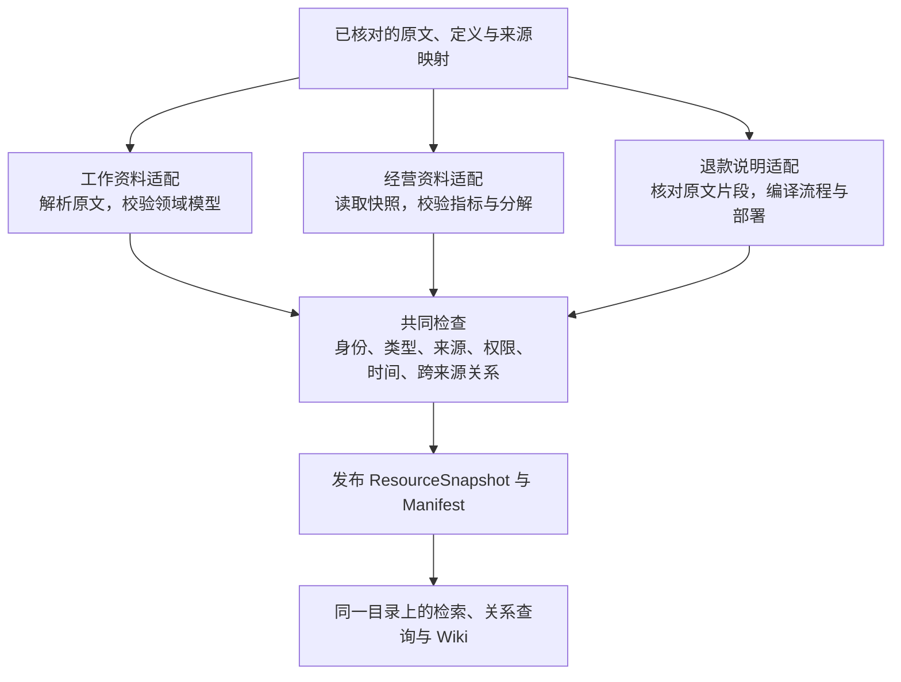
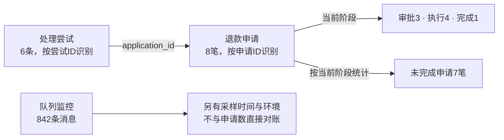

# 第 16 章 让系统按企业的含义连接知识

> 本章要回答：怎样把业务问题变成可检查的模型，再用符合模型的资料生成关系路径、Wiki 和架构核对结果？

第15章已经让我们能够找到一份有来源、有版本、权限正确的材料。现在，开发者提出一个进一步的问题：“如果修改 `order.cancelled`，哪些消费者和测试需要一起评审？”搜索可以找到提到这个事件的文件，但文件中出现同一个词，并不等于它们存在消费或测试关系。

要回答这个问题，系统需要先知道什么是事件契约、什么是消费者、什么证据能证明消费关系。随后，它才能把具体事件、函数和测试连起来，并按用户需要返回路径或阅读页面。**本章的主线是：先约定含义，再检查实例，最后把合格的资源组织成不同视图。** 来源变化后，视图还必须能够重新生成。

我们先用事件变更理解建模方法，再补出退款业务、流程和技术实现之间的联系，最后接入经营资源。它们都进入同一条资源建设流程，共用对象目录、检索、关系和 Wiki。到第17章，平台才会把选中的材料与本次任务条件、工作进展和行动边界放在一起。

## 16.1 本章要构建什么：从对象到模型，再到视图

回到第14.2节的系统图，本章主要实现 `NorthstarPlatform` 中的模型校验、关系导航、Wiki 和架构核对。这里有三个连续但不同的产物：

| 产物 | 在事件变更问题中是什么 | 用来做什么 |
|---|---|---|
| 模型 | `EventSchema`、`CodeSymbol`、`Test` 的定义，以及 `CONSUMED_BY`、`TESTED_BY` 的规则 | 规定对象和关系在业务里是什么意思 |
| 符合模型的实例 | `order.cancelled v2`、具体消费者、各自的测试，以及带依据的边 | 保存这一版资料中有哪些对象，它们怎样关联 |
| 面向用途的视图 | 消费者与测试路径、按系统组织的 Wiki、声明与实现的差异 | 帮助人或程序查证、阅读与复核 |

模型不会凭空产生事实。声明“事件可以被代码消费”，并不能证明某个函数确实消费了某个事件；还需要从来源取得对象和关系实例。视图也不会增加事实的权威性：把一条未经核实的声明排成页面，并不会使它成为已验证的结论。

接下来的构建沿着这条主线推进：16.2节设计领域模型，16.3节将其编译为程序可检查的契约并验证实例；16.4节把建模范围扩展到企业结构与指标；16.5节再说明如何从这些资源生成视图。16.6节处理更新，16.7节完成验收和与下一章的交接。

这里的“视图”是对已有资源的一种选择、组织或比较方式，不要求使用数据库视图，也不要求预先保存一份副本。Northstar 的关系查询、Wiki 和架构核对都在请求时用 Python 内存计算完成。

## 16.2 设计领域模型：把工作问题写成明确的约定

第15章已经说明材料来自哪里、谁能看、何时有效。本章继续解释它在业务里是什么意思，能与谁建立关系，又凭什么这样连接。例如一份 Markdown 即使标好了版本和权限，里面的“服务”“消费者”仍需要明确定义，程序才能正确使用。

Northstar 的 C3 将领域建模产物分成五类：

| 产物 | 回答的问题 | Northstar 文件 |
|---|---|---|
| 能力问题 | 模型必须支持哪个判断或行动？ | `data/modeling/competency-questions.json` |
| 术语表与边界 | 同一个词在这里精确指什么，由谁负责？ | `data/modeling/glossary.json` |
| 概念与逻辑模型 | 有哪些对象类型、身份、生命周期和关系契约？ | `data/modeling/concept-model.json` |
| 源映射 | 哪个系统用什么身份规则产生对象或关系？ | `data/modeling/source-mappings.json` |
| 编译模型与验证报告 | 定义是否完整且互相一致，当前数据能否支持能力问题？ | `generated/domain-model.json`、`generated/model-validation.json` |

C3 的前四类输入是建模工作的产物，可以由业务专家和平台团队编写，也可以由助手起草、再交给负责人确认；最后一类由程序生成。随书文件保留一组已确认的结果，C8 则让读者从新材料观察候选怎样形成。改变定义后应重新编译，避免生成文件与已确认规则不一致。

下面按这些约定的形成过程，依次确定问题、词义、身份、关系与来源。每一步的决定，都会成为后面校验实例和生成视图的依据。

### 16.2.1 从能力问题确定边界

先列出模型必须帮助回答的问题，这就是能力问题。“建设企业知识图谱”还太笼统，无法据此验收。Northstar 的 C3 选择了三个具体问题：

1. API 变化时，哪些服务、代码仓、值班团队和 Runbook 必须进入评审？
2. `order.cancelled` 变化时，哪些消费者和测试构成最低影响范围？
3. 一次退款事件发生时，哪一版政策在该地区有效？

每题除了自然语言，还记录所支持的决策、必需对象类型和关系类型。例如第二题要求模型至少能表达 `EventSchema -> CodeSymbol -> Test`，并在样例中找到 `CONSUMED_BY` 和 `TESTED_BY` 的实例。第三题则要求区分政策的生效时间、事件发生时间和平台记录时间。

能力问题在这里有三个作用。第一，它限制建模范围，避免团队试图一次描述整个企业。第二，它决定先接入哪些数据源，避免先处理与任务无关的资料。第三，它直接成为验收题，避免只列出类型，却没有具体对象和关系来支持回答。新增类型时要说明它服务哪个问题。新增问题如果需要模型尚未定义的关系，构建就应报错，提醒维护者补齐规则。

### 16.2.2 先统一语言，再定义类型

术语表除了记录名称和别名，还要写清定义、适用业务范围和负责解释的人，并用反例说明什么不算。Northstar 特别区分以下几个容易混淆的概念：

- `Service` 是独立运行的服务，`Repository` 是保存版本化源码的仓库；一个仓可以包含多个服务，一个服务也可能用到多个仓，不能仅凭名称把它们合并。
- `EventSchema` 规定一种事件的格式和版本，`RefundEvent` 则记录一次实际发生的退款事件；前者用于检查代码兼容性，后者用于判断当时适用哪条政策。
- `Team` 表示团队，`ON_CALL_FOR` 表示某段时间内负责值班；提交过代码的人不一定是当前服务负责人。
- `Runbook` 是经过审核的处置手册，`Incident` 是一次运行异常；事故处理中提出的猜测，需要核实后才能写进手册。

同一个词在不同业务里可能有不同含义，因此还要标明它的适用范围。建模中把这种范围称为“限界上下文”。事件与运行部分设交易业务、软件工程和生产运行三个范围。`modeling.py` 拒绝同一范围内的术语重名或别名冲突；不同范围可以保留同名词，但查询时要带上范围标识。词义有争议时由术语负责人处理，来源数据有误时则由数据源负责人处理。

### 16.2.3 确定身份、生命周期和时间

词义说清后，再判断哪些概念需要单独建对象。如果它要被持续跟踪、有自己的版本变化，或需要单独设置权限和建立关系，通常就值得有独立身份。Northstar 因此把政策、事件契约、事件实例、服务、仓、API、团队、Runbook、代码符号、测试、ADR 和事故建成类型；“队列积压严重”则是观察或状态，不必仅因名称里有一个名词就新建对象类型。

每个类型必须声明身份规则。`Service` 使用服务目录 ID，`Repository` 使用规范 Git URL，`CodeSymbol` 使用仓、提交和符号三元组，`Policy` 使用政策 ID 与版本。身份规则的作用是阻止同名误合并，并让来源变化时仍能判断“同一对象的新版本”还是“另一个对象”。样例没有在每个对象中展开所有业务主键字段，但来源映射会说明怎样用这些字段生成统一 ID。真实接入时，还要记录身份解析失败，以及同名对象合并或分开的理由。

对象怎样变化，决定了需要记录哪些时间。政策、事件契约和 ADR 会版本演化；事件实例在某一时间发生；服务值班和调用关系也可能只在一段时间内成立。模型中的 `temporal: true` 不是自动实现历史查询，而是要求具体存储和查询保留有效时间，不能把今天的关系直接当成过去也成立。

### 16.2.4 给关系写清方向、证据和反例

如果只把相关对象连上，并统一标成 `RELATED_TO`，查询时仍不知道“相关”到底指什么。事件与运行部分从能力问题出发，定义八种具体关系。每种关系写清起点和终点的类型、方向、允许一对一还是一对多、是否随时间变化，以及需要什么证据，再给出正例与反例。

例如事件影响题需要：

```json
{
  "CONSUMED_BY": {
    "from": "EventSchema",
    "to": "CodeSymbol",
    "cardinality": "one_to_many",
    "allowedEvidence": ["deterministic", "resolved"],
    "temporal": true,
    "meaning": "代码符号消费符合该事件契约的消息。",
    "negativeExample": "函数名包含 cancelled 但没有解析到订阅关系。"
  }
}
```

实例边必须进一步说明这一次关系为什么成立：

```json
{
  "from": "event-order-cancelled",
  "type": "CONSUMED_BY",
  "to": "code-refund-consumer",
  "evidence_tier": "resolved",
  "evidence": "code://northstar/refund-worker@abc123/consumer.py#handle_order_cancelled",
  "time": {
    "valid_from": "2026-08-20T00:00:00Z",
    "valid_to": null,
    "observed_at": "2026-08-27T00:00:00Z"
  }
}
```

模型规定一种关系允许表达什么，实例证据则说明这一条具体关系为什么存在。交换主客体后，边不再符合契约；仅凭名称相似得到的候选，也不能伪装成 `resolved`。

`GOVERNED_BY(RefundEvent, Policy)` 除了限制两端类型，还要求地区匹配，并且**政策有效区间**要覆盖事件发生时间。关系本身的有效区间则回答另一个问题：系统从什么时候起采用这条“事件适用某政策”的解释，到什么时候又将它纠正。

因此，`many_to_one_at_event_time` 并不表示“一个事件永远只能出现一条政策边”。同一事件可以保留先前映射和后续纠正，但指向两个不同政策的**关系有效区间**不能重叠。这样既能保存修订历史，也不会让同一个解释时刻出现两份互相冲突的适用政策。

不要用事件发生时间检查关系的修订窗口，否则事后纠错会被误判为非法。两条时间线各管一件事：事件发生时间用来选择当时适用的政策版本；关系有效时间用来选择系统在某个时刻采用的解析结论。因此，保存关系时也要留下依据和时间，才能说明为什么这样连，以及后来为什么改变。

### 16.2.5 把模型接到来源和责任人

模型定义要保存哪些对象和关系，来源映射则说明去哪里取得它们。Northstar 为每个来源记录负责人、可产生的类型或关系、身份解析规则和刷新方式：服务目录产生 `Service`、`Team` 与 `ON_CALL_FOR`；代码索引产生仓、符号、测试和解析关系；文档系统产生政策、Runbook 与 ADR；运行追踪可以产生 `observed` 的 `CALLS`，却不能覆盖架构仓库中的 `asserted` 声明。

同一种关系允许多种来源，不代表它们权威性相同。代码解析说明当前固定提交中解析到调用，架构声明说明设计上应当调用，运行追踪只说明观察窗口中实际发生过调用。存储时可以使用同一种关系类型，但要保留证据等级、来源、版本和时间，查询时才分得清“应该如此”“代码如此”和“观察到如此”。

来源映射也能帮助发现缺失的接入。如果模型声明 `Incident`，却没有任何系统能稳定提供事故 ID，那么这个类型尚不能实例化；如果能力问题需要 `TESTED_BY`，而代码索引只输出文件文本，就还无法支持这道验收题。C3 构建时要求每个类型和关系至少登记一个来源。生产系统还要进一步检查字段和 ID、来源冲突时以谁为准、删除怎样处理，以及负责人多久完成修复。

这些映射说明计划怎样接入；样例还没有实现服务目录、追踪系统或多仓代码连接器。接下来补出退款业务到技术实现的联系，再把实例交给共同编译入口。

### 16.2.6 让不熟悉退款业务的人也能找到入口

现在换成一个新同事：他知道有人报告退款积压，却不知道退款规则、服务名和队列在哪里。只给他一份 Runbook 还不够。资源要先解释“消费者购货中为什么会有退款”，再让他沿关系找到流程、规则和实现。

`data/raw/business/refund-journey.md` 是本例新增的业务与运行说明。它包含消费者购货价值流、退款能力、正常处理步骤、例外、服务分工、部署和监控。`data/refund-map.json` 保存对这份原文已经核对的解释：每个对象与关系都带原文片段，程序检查片段确实存在，再按类型和身份约定编译。这里由作者完成解释；实际企业可以通过访谈、代码走查和助手候选形成同样的映射。

先看业务部分。图中的方框是具体对象；“包含步骤”表示组成，“正常条件下下一步”表示顺序，其他箭头表示业务联系。图由资源数据生成，每条边都能回查原文依据。

<!--@include: ../.vitepress/theme/generated/refund-business.md-->

“核对取消与政策”读取适用规则；满足条件后，才进入请求付款退回与核对支付结果。`ProcessStep` 的属性记录顺序，以及转人工或待重试条件。这个小模型用于讲清业务、查找材料；它没有部署业务流程执行引擎，也没有模拟实际付款。

同一条流程中，能力、步骤和政策属于业务内容，退款服务属于应用内容。它们通过“由服务支持”相连，读者不需要先猜文件在哪个目录。16.5节继续把这条关系接到部署、队列和监控，形成一条完整的查证路径。

## 16.3 编译和验证：让约定真正约束数据

模型写好之后，系统需要检查两件事：约定本身是否完整且自洽，具体对象和关系是否遵守约定。通过检查的资源，才能进入后面的查询与视图生成。

Northstar 的共同入口是 `resource_pipeline.compile_resources()`。平台启动、政策更新和助手候选试编译都经过这个入口。它先调用来源适配器，再检查整批资源，全部通过后才返回一个可发布快照。



各个适配器都输出对象、关系、模型约定和校验报告。工作资料保留事件与代码的专门检查，经营资料保留期间、币种和金额对账检查；共同检查则防止重复身份、无依据的边、错误端点和跨租户连接。任何一路失败，新的快照都不会交给平台使用。这样既能采用不同的解析方法，也能保持统一的发布和使用方式。

### 16.3.1 分清模型、实例和生成产物

`compile_domain_model()` 读取四份建模输入，将能力问题、术语、类型、关系和来源映射组合成运行模型。实例走另一条输入路径：`compile_knowledge()` 将五份 raw 来源编译结果与十四个补充对象合并，十三条关系则从 `relations.json` 读取。

两路输入在校验时放到一起：模型规定“消费关系允许怎样表达”，实例说明“这一个事件由哪一个函数消费，以及依据是什么”。原始编译器会提取指定的 Python 函数，但不会自动解析出这些消费、调用和测试关系。生产接入需要由各自的解析或采集过程产生实例，再通过相同契约检查。

Northstar 用四种标签说明关系依据从哪里来：

- `deterministic`：由结构化来源直接确定；
- `resolved`：通过符号、代码或受约束解析完成实体解析；
- `observed`：在运行数据中实际观察到；
- `asserted`：来源或责任人作出的声明，可能描述要求、设计或现状。

第 8 章还区分 `heuristic`（启发式匹配）与 `inferred`（推断）；它们应保留推导依据和复核状态。`candidate` 表示待复核状态，不是另一种证据来源。正式使用前，还要检查对象类型、关系方向、来源位置、版本和时间；无法确认身份的对象应交给人复核。

程序分别用 `evidence_tier` 记录取得方式、`statement_kind` 记录声明性质、`review_status` 记录审核状态。例如经营关系中的候选原因仍是来源声明，但性质为 `hypothesis`，状态为 `candidate`。代码调用边描述 `implementation`，运行追踪边描述 `observation`；二者的证明范围不同。`reviewed_fixture` 只表示作者核对过这组教学设定。

Northstar 的十三条关系由人写入 `relations.json`，上述等级表示样例所模拟的来源类型。当前程序检查标签是否符合关系契约、证据字段是否存在，但不验证引用真实性，也不执行跨仓符号解析或采集真实追踪。因此，读者可以用它练习证据规则，实际建图时仍需实现并验证相应的提取过程。

### 16.3.2 检查模型，再用实例回答验收题

`build_domain_model.py` 先检查定义，再检查具体数据。

检查定义时，程序确认术语是否冲突、对象是否有身份规则和适用范围、关系两端类型及数量规则是否正确、能力问题是否引用了已定义的类型和关系，以及它们是否有来源负责人。

工作资料适配器先检查原有的十九个对象和十三条关系。对象类型必须已定义，关系方向、证据标签和时间字段必须符合规则。样例还要求该领域模型中定义过的类型和关系都有实例，并检查每道能力问题需要的对象和关系能否连成一组可用材料。随后，共同入口将其与退款说明、经营快照合并，检查整批八十个对象和六十九条关系。

```bash
cd examples/enterprise-case
python3 src/build_domain_model.py
```

摘要中的 `valid: true` 和 `supported_questions: 3` 表明三道能力问题在当前样例中都有对应的对象和关系。`generated/model-validation.json` 还为每道题列出样例对象和关系证据。读者可以把第一条 `CONSUMED_BY` 边的起终点交换，再运行测试，观察构建因“源类型必须是 EventSchema”而失败；也可以删除时间边的 `time`、移走一种关系实例，或在同一边界制造重复术语，观察这些不完整状态在图生成前被拒绝。

这里的 `supported` 只证明回答问题所需的类型和关系在教学数据中有连通实例。它不验证引用所指内容的真实性，也不证明检索已经找全或模型生成的答案正确。后续图查询测试验证路径，Golden Questions 验证任务行为，人工评审验证业务定义。定义是否自洽、实例是否合规、查询是否正确、答案是否可靠，需要分别检查。

Northstar 启动时会重新编译并验证模型，资源版本标识 Manifest 的计算也包含模型内容。因此，修改术语、类型或关系契约会改变资源快照的 Manifest，下一次构造上下文时会引用这个版本；模型与数据不兼容时，启动会报错。上下文包还会在 `semantic_contract` 中返回本次证据所需的类型与关系定义，让 Agent 读到明确规则。

### 16.3.3 在 C3 中对照定义与实例

在下面的实验里，先阅读编译函数如何把四份建模输入连起来，再查看 `semantic_slice()` 怎样只取当前材料需要的定义。执行后，将一条 `CONSUMED_BY` 定义和它的实例边放在一起核对：两端是什么、方向是什么、证据是什么。要改变模型，请在本地编辑 `data/modeling/`，运行校验后重新构建并启动书站。页面中的角色切换只改变可见材料，不会修改模型定义。

<NorthstarLab lesson="C3" />

做完失败实验后，改回自己刚才修改的内容，确认编译通过，再继续视图实验。此时得到的是有明确类型和证据规则的资源集合，还没有替任何具体任务决定应该读取哪些材料。

### 16.3.4 在 C8 中从新原文构建资源

前面的 C3 展示了已经确定的模型怎样运行。现在换一个起点：收到一份退款限流核对说明，里面提到 `refund-worker`，但还没有类型标注、对象 ID 或图关系。我们希望让助手提出整理方式，再按刚学过的规则核验。

这个实验依次产生五项结果：

| 步骤 | 输入与处理 | 可以检查的产物 |
|---|---|---|
| 登记原文 | 维护者粘贴材料，平台分配来源 ID 和版本 | 原文、责任人、版本；尚未成为正式知识对象 |
| 提出候选 | 助手读取原文及获准的服务目录 | 标题、类型说明、能力问题、服务关系及逐字引文 |
| 试编译 | 检查字段、可见端点和引文，再复用模型与实例校验 | 候选模型与验证报告；当前资源尚未切换 |
| 审核发布 | 维护者核对具体候选并写明理由 | 新对象、关系和模型版本，保留审核记录 |
| 重新使用 | 原有检索、图和 Wiki 读取新资源 | 可搜索的正文、有出处的关系和更新后的页面 |

默认演示提出 `DiagnosticNote`，表示记录排查条件的说明，并建立 `DESCRIBED_IN_DIAGNOSTICNOTE`，从服务指向这份材料。这条边只说明材料描述该服务，不表示存在调用或事故因果。真实模型也可以提出复用 `Runbook`、`ADR`，或一个新的说明类型；本例不允许它覆盖其他既有类型。新增名称应由人核对，避免把每份文档都建成新类型。

`resource_candidate()` 限定模型可提出的字段，并检查引文确实出现在原文。随后，`materialize_resources()` 在临时副本中补齐术语、类型、来源映射、能力问题和关系实例，交给同一套编译与校验代码。来源身份、责任人、访问范围和引用地址由程序提供，不从模型回答复制。

在本地先用 product 角色登记默认原文，建立资源建设任务，点击“生成本步建议”。逐项核对候选和原文，再填写审核说明并发布。回到 C1 搜索“限流窗口”，到 C3 查看新增类型，到 C4 从 `service-refund-worker` 查看关系与 Wiki。切换 support 后，新说明不应出现在检索结果中。

<ContextAssist kind="resource" />

结构检查不裁决业务含义。即使引文真实存在，它也可能不足以支持关系；此时应拒绝候选，修订材料或调整问题后再来。这里的 product 兼任教学资料维护者和审核人，未实现独立评审人制度。公开页面的示例来自手写脚本；只有选择并配置真实模型，才会实际调用模型生成建议。

## 16.4 扩展建模范围：从事件影响到企业经营

前面的模型围绕工程和运行问题建立，但方法并不限于这些领域。如果经营负责人问“H2 的销售为什么比 H1 差”，仍要先确定问题边界、统一词义、定义对象与关系、标明来源，再验证资料是否足够。

这次，关键对象变成商业模式、战略目标、业务能力、组织、应用、数据产品与指标。它们属于第1、8章描述的企业内容体系。本节先备好这些资源，第17章再实现经营任务的口径确认、上下文保存与人工复核。

### 16.4.1 用经营问题串起企业内容

经营负责人问“H2 为什么比 H1 差”，第一步要先确认比较的是什么。C7 选择已确认订单净额，使用相同币种与半年度边界，明确折扣、撤销和退货的处理规则；收入、回款和 GMV 不能直接代入。然后才把这个指标接回企业经营模型。

打开 `data/strategy-context.json`，可以逐一找到第 1、8 章的六方面内容：

| 企业内容 | 快照中的对象 | 对这道题有什么用 |
|---|---|---|
| 外部环境与商业模式 | `enterprise_profiles`、`external_factors` | 了解企业靠什么创造收入，哪些外部信号值得核查 |
| 战略目标与经营安排 | `strategic_objectives`、`metric_definitions` | 确定经营目标、指标口径和比较标准；当前未展开预算模型 |
| 业务能力、产品与流程 | `business_capabilities`、`value_streams`、`business_processes`、`products` | 找到销售、渠道、定价能力及其工作安排 |
| 组织、责任与资源 | `business_units` 及责任关系 | 找到复核责任人；当前未展开人员、设备与资金台账 |
| 应用、数据与技术基础 | `applications`、`data_products` | 找到指标数据来自哪个应用，已有哪份快照 |
| 运行状态与工作历史 | `observations`、`events` | 核对实际金额和候选事件；本次调查记录另存为任务记忆 |

区域、客户群和渠道还为观察提供分组范围，分别关联市场和业务内容。下面按经营角色的可见范围，从校验后的资源生成一张结构图。箭头表示对象关系，不表示系统执行顺序。

<!--@include: ../.vitepress/theme/generated/sales-structure.md-->

从目标到指标再到数据产品，可以查金额是怎样取得的；从能力到流程和组织，可以找需要参与核查的人。两条路线共享企业背景，关系本身不证明某个团队或应用造成销售下降。

再看 `data-pipeline-facts`：模型知道它由 CRM 提供，但 `snapshots` 为空。因此，系统知道下一步应该找销售漏斗数据，却不能把“已经定义数据产品”当成“已经取得数据”。经营资料中的 `service-order-ledger` 与退款说明中的 `service-order` 尚未建立经核验的身份映射，平台保留两个来源的标识，不因名称相近就合并。它也没有订单流水连接器。

### 16.4.2 验证指标、关系和可比较事实

现在用代码检查这组约定。`StrategyResources._validate()` 检查对象身份、关系端点、字段引用、指标定义、数据快照、期间和单位，并要求区域、产品、客群、渠道四个分解视图分别对齐同一总额。它还检查观察范围与 `SCOPED_TO` 关系一致。这是经营来源的专门检查，随后还要经过16.3节的共同校验和版本发布。扩展新经营问题时，要补上所需目标、负责人和数据路径的验收查询。

四种分解使用的是同一批订单的不同切面，不能跨维度相加，也不能仅凭单维度金额推导联合分组。它们能够说明下降集中在哪里，不能单独解释为什么下降。

如果 EMEA 销售下降和渠道冻结都发生在 H2，平台可以返回候选关联；只有补充客户级订单、时间序列、对照数据和责任人复核，才能继续讨论因果。这个模型既帮助找证据，也让缺少的证据有了明确名称和来源。

下面单独画出观察与候选事件，以免与企业结构挤在一起。实线说明观察的分组范围，虚线说明待调查的关联；它们都来自同一份经营资源。这里的金额单位是千美元。

<!--@include: ../.vitepress/theme/generated/sales-observations.md-->

这份合成经营快照使用2027年1月2日的资料时点，覆盖完整 H2；运行处置练习的时钟则是2026年8月27日。通用搜索、关系和 Wiki 查询经营资料时，应显式采用经营快照时点和获准角色。平台不会把尚未取得的半年数据放进8月的任务材料。C7 的指标工具已经绑定这份固定快照。

### 16.4.3 来源各有检查，资源共同发布

`modeling.py` 检查工作资料的领域约定，`strategy_resources.py` 检查经营快照的指标约定。两者都是 `compile_resources()` 中的来源适配环节，检查结果进入共同的 `ResourceSnapshot`，平台不再另起一路装载经营资源。`strategy.py` 只保留查询时的指标确认、取数与计算，使用已经校验的经营资源。

共同目录复用了能力、价值流和流程类型，并保留每个实例的身份与来源。经营画像 `enterprise-northstar` 也连接到消费者退款能力；这条边只表达企业包含这项能力。读取时必须同时有权查看两端，不能顺着一条边越过权限。退款队列条数与销售金额仍是不同指标，不能直接互相换算。

到这里，经营和运行资料已经处在同一份资源快照中。下一节再按用途组织成阅读和查询视图。

### 16.4.4 保留业务明细的粒度，让数字可以复算

经营样例已有汇总数据，退款调查还需要理解更细的业务记录。`data/refund-records.json` 增加了一组明确标为合成数据的固定快照：8笔申请，其中3笔处于审批阶段、4笔处于执行阶段、1笔已完成；另有6条处理尝试。两组记录分别以申请ID和尝试ID识别，尝试通过 `application_id` 关联申请。



`validate_records()` 在共同资源编译时检查重复身份、未知阶段和不存在的关联申请。`read_records()` 按权限读取，再分别统计申请与尝试，保留原行、快照时间、粒度和内容散列引用。它没有把申请连接尝试后的行数当成申请数，因此一笔申请多次重试也不会重复计入未完成数量。

这些明细作为 `ResourceSnapshot` 的业务数据保存，不会为了检索而全部改写成文档或图节点。`business` 工具在任务需要时读取它们。队列的842条消息来自另一份运行样例，单位和环境都不同，不能用7笔未完成申请解释842条消息，也不能据此确认积压根因。读者应先核对范围，再决定能比较什么。

## 16.5 从模型与实例生成三种知识视图

面对同一批资源，读者可能要做不同的事。开发者要追踪影响路径，新同事要先读懂一个系统，架构负责人要比较设计声明与实现证据。这三种需求分别对应关系查询视图、Wiki 阅读视图和架构核对视图。

它们通过对象 ID 和引用保持关联，各自读取需要的输入。Northstar 的实现关系如下：

| 视图 | 输入 | 核心处理 | 返回结果 |
|---|---|---|---|
| 关系查询 | 可见且时间合适的对象与边、起点、允许的关系 | 构造邻接表，按方向和跳数遍历 | 保留原始方向、证据及已有时间信息的边 |
| Wiki 阅读 | 当前角色可见、时间合适的对象正文与引用 | 按系统分组，用模板组织页面 | 页面、章节与输入引用 |
| 架构核对 | 架构声明、固定快照的关系证据、可见对象集合 | 在同一比较范围内做集合对照 | 有声明有证据、有声明无证据、有证据无声明三组结果 |

通用关系查询和 Wiki 现在读取同一份资源目录，包括工作资料、退款流程与经营资料。架构核对还需要单独的设计声明及比较范围，当前样例只配置了退款服务调用核对，因此不会凭经营对象存在就自动产生经营架构差异。指标计算仍由经营工具完成。

### 16.5.1 关系视图：把合格的边变成可追溯路径

先继续事件变更问题。模型已经规定消费与测试的含义，实例中也已有具体边。生成查询视图时，需要做四件事。

第一，按主体的租户、角色和查询时间筛选对象，并筛选边的时间。第二，把两端都可见、类型符合本次查询要求的边放进邻接表。第三，从 `event-order-cancelled` 出发，先到三个消费者，再到各自测试。第四，返回经过的原始边及其证据，而不只返回六个名称。前两步由 `NorthstarPlatform.trace()` 与 `trace_dependency()` 协作完成，遍历实现在 `knowledge_views.py` 中。

开发者应获得三条消费边和三条测试边。路径的意义是：“现有证据支持这条关系，需要把它列入评审范围。”它不保证生产系统里的全部消费者已经找齐。Northstar 使用人工编写的有限样例；生产查询还需要验证提取覆盖率。

查询方向也要与业务关系方向分开。事件题沿 `EventSchema -> CodeSymbol -> Test` 前进即可。API 变更题则从 `api-create-refund` 出发，需要反向找到 `Service -> API` 和 `Repository -> API` 的服务与仓，再继续找团队和手册。反向导航只是查询方式，返回的边仍保留原来的业务方向。

选定能力问题后，`context()` 会把该问题需要的关系集合交给图查询，并允许反向导航。通用 `trace()` 默认只沿声明方向。例如 `CQ-IMPACT-001` 只允许 `CALLS`、`IMPLEMENTS`、`ON_CALL_FOR` 和 `DOCUMENTED_BY`。教学遍历器限制跳数，并不让同一路径重复经过同一种关系，避免从目标 API 经一个服务又横向扩展到另一个 API；实际使用时，还应限制节点数、路径数和耗时，并定义更准确的查询路线。

生成查询路径前就要检查权限。support 无权查看事件与代码，连起点都不应进入其可查询范围。对同一问题返回空路径，和“企业里没有消费者”是两件事。查询方需要知道自己拿到的是哪一范围内的材料。

代码仓规模增大后，仓、目录、符号、测试和提交可以组成子图，仓之间再通过 API、事件和依赖连接。这里继续使用一个逻辑仓的教学切片；源码结构提取、Tree-sitter、SCIP 与大型代码库实践在[第18章](../part-5/chapter-18.md)继续讨论。本章先把路径语义、证据和权限验证清楚。

先把退款的另一半关系画出来。这次采用 developer 的可见范围，展示从事件代码到服务部署的联系；看见监控入口，不代表拥有读取监控或执行操作的权限。

<!--@include: ../.vitepress/theme/generated/refund-runtime.md-->

图中的部署关系来自教学说明，消费关系保留已有代码证据，两者各有依据。队列的身份是 `refund-queue`，监控入口通过 `runtime_resource` 指向它；当前条数通过运行适配器读取，不写在静态关系图里。

`resource_discovery.py` 中的 `investigate_refund()` 演示新同事怎样调查：搜索消费者退款能力，从返回的能力对象出发，沿流程到政策和服务，再到部署、队列和监控入口；最后用发现的资源标识读取状态，并取出处置手册。它使用明确写好的调查路线，没有预填业务入口或队列 ID。下面的 C4 网页实验和 `resource_demo.py` 命令行入口调用同一个函数。

```bash
python3 examples/enterprise-case/src/resource_demo.py
```

初始读数是842条，返回结果同时列出业务和技术材料的引用。这个命令只调查，不执行重放。换成 support 后仍能理解业务流程，但不能取得技术部署和队列读数；第17章继续展示有权角色怎样准备、批准和执行动作。

### 16.5.2 Wiki 视图：把可见对象组织成阅读入口

关系路径适合回答“会影响谁”，但新同事可能先要知道“退款系统有哪些重要资料”。这时无需让他逐条走图，可以把相关对象组织成一页可读的材料。

Northstar 的 `build_role_scoped_wiki()` 接收已经按角色与时间选好的对象，按 `system` 分组，在组内按对象种类和 ID 排序。每个对象形成一个章节，保留标题和正文；页面的 `inputs` 收集所用对象及其版本引用，`page_id` 包含系统和角色。这样，同一系统可以为不同权限角色生成不同页面。

丰富的 Wiki 可以结合对象和关系解释职责、依赖与流程；当前函数只按对象分组，没有遍历图，也没有让模型写摘要。返回字段虽然叫 `summary`，填入的仍是对象正文。读者可以在下面的源码面板直接核对这个过程。

验收一页 Wiki 时，除了看正文，还要展开 `inputs`，确认每段材料能回到所用版本。切换到 support 后，页面只应由其可见对象重新生成，不能先生成开发者页面再靠前端删去代码段落。

这些引用说明页面由哪些材料生成。目前每次请求都重新生成页面，没有后台队列自动查找并刷新受影响页面。队列深度、余额和待审批动作也不应被当作稳定事实复制进页面；Wiki 可以解释它们的定义和查询入口，当前值应另行读取。事故中的猜测可以保留在任务记录中，经过复盘与责任人审核后，才可能进入新的 Runbook。

企业概览、目标、能力和价值流页面可以沿用“选输入—组织页面—保留引用”的方法，但需要接入16.4节的企业模型并设计相应模板。Northstar 尚未生成这些页面，不能把现有按系统分组的 Wiki 当成企业全貌。

### 16.5.3 架构核对视图：比较设计声明与已有证据

前两种视图都在组织已有材料，第三种需要比较两组含义不同的材料。一组是架构资产声明某服务应调用哪些 API；另一组是代码或运行样例提供了哪些调用证据。它们通过相同对象身份对齐，但不能互相覆盖。

`compare_architecture_claims()` 接收平台从 `architecture-claims.json` 加载的设计声明和比较范围。当前范围是退款服务的 `CALLS` 关系。函数先检查关系类型和端点权限，再选择性质为实现或观察、状态为已核对教学资料的证据，核对环境、实现版本及时间。取得方式为 `asserted` 的实现声明也可以参与比较；取得方式本身不决定内容是什么。可比材料按 `(from, type, to)` 对齐，不可比材料单独返回。

| 结果 | Northstar 中的例子 | 接下来应怎样理解 |
|---|---|---|
| `declared_and_evidenced` | `refund-worker -> create_refund` | 当前比较范围内，声明有证据支持 |
| `declared_not_evidenced` | `refund-worker -> legacy_refund` | 尚未找到支持证据，需核验覆盖范围和来源 |
| `evidenced_not_declared` | `refund-worker -> risk_check` | 有证据但未纳入声明，需检查是否遗漏、误报或未登记变更 |
| `not_comparable` | 将证据环境改为另一环境后得到的结果 | 范围或时间不匹配，先补齐可比依据 |

输出同时保留声明来源和关系证据，便于责任人决定是更新设计、修正实现，还是修复采集过程。它不会自动改代码，也不会把“没有证据”直接判成“没有实现”。这组样例没有完整表达否定声明，因此尚不能自动判定任意两项声明互相矛盾；当前结果用于指出待核对差异。

这项核对使用明确编写的固定架构快照，与“查询某一时刻哪些边有效”是两种用途。例如 `risk_check` 的证据来自样例中的特定观察窗口，出现在比较结果中不表示它现在仍在调用。当前函数也没有持续扫描生产系统或维护待办队列。

16.4节的企业经营模型描述企业如何运作；本节从应用架构中选取一小段声明来核对。企业架构可以为两者提供建模依据，但经营差异计算和声明对照不是同一项算法。

### 16.5.4 在 C4 中走完退款查证，再比较三种视图

现在用 C4 把前面的资源连起来。默认角色为 SRE，操作区域为“退款业务查证”。在本地创建或恢复实验空间，点击“执行退款查证路线”。页面按四步展示本次实际结果：找到业务入口、沿关系取得资料、读取当前状态、整理处置手册。每一步都能展开对象和调用条件；下方的材料卡片保留正文、类型、版本和引用。

第一次运行应看见842条积压、310秒消费延迟和1%的支付方错误率，以及退款积压处置手册。交付区另列业务快照中的7笔未完成申请，并注明这是按申请粒度计算的结果。展开每项发现的引用，再对照政策和手册。源码面板中的 `refund-journey.md`、`refund-map.json`、`read_records()` 和 `investigate_refund()` 分别对应原始说明、建模结果、明细计算与查询过程。四步导航记录后还会读取业务快照；完整调用顺序保留在取证计划中。本实验不调用模型，也不执行重放。

接着试两个边界。切换 support 再执行，应仍能取得业务流程和政策，但没有可见部署、监控读数和处置手册。回到 SRE，点击“推进61秒，测试过期”后重新执行，业务材料仍在，当前观察则应显示缺口。新建空间可恢复初始状态。developer 能看见技术路径，但没有读取当前队列的权限，说明“找到监控入口”和“能读监控”是两件事。

同一个 C4 也保留原来的三种视图实验：切换 developer 和“关系导航”，从默认起点 `event-order-cancelled` 查看消费者与测试；再切换 Wiki 核对正文和输入引用，最后切换“架构核对”检查声明与证据的差异。每次切换后执行当前实验。通用关系导航采用两跳正向查询；退款查证路线则采用限定关系类型、最多八跳及反向导航，查询条件在结果中可见。

公开书站提供固定的 SRE 退款查证示例，并标明示例角色和操作；改变选择不会重算构建时示例。实际执行需要本地工作台。C3 检查模型与实例的约定，C4 使用固定路线调查，C9 让助手选择下一步。C4 与 C9 共用读取工具和 `deliver()` 交付约定；C6 的动作流程仍须独立创建业务任务并取得批准。

<NorthstarLab lesson="C4" />

通过这一组实验，读者应能说明每项输出用了什么输入、做了什么处理，以及没有证明什么。只有这样，下一章才能选择合适材料，而不是把各种输出无差别拼到提示词里。

## 16.6 资源变化以后：重验实例，重建视图

有了多种视图，下一步自然是处理变化。如果正文已经更新，Wiki 却还展示旧内容，或者关系契约已经改变，查询仍返回不合规的边，那么前面的建模工作并没有真正约束运行系统。

### 16.6.1 先判断改变的是含义，还是具体资料

这两类变化的处理不同。如果 `Service` 的身份规则从名称改成服务目录 ID，改变的是模型，需要评审新规则、迁移实例并重新验证依赖它的查询。若退款消费者在新提交中不再订阅某事件，改变的是实例，应更新对象和消费关系，再重跑影响分析题。

视图按自己的输入决定如何重建。关系查询依赖对象和边；Northstar 的 Wiki 依赖对象正文与引用；架构核对还依赖声明和比较范围。因此，仅修改一条关系，不会改变当前模板 Wiki 的正文。如果将来在 Wiki 中加入关系说明，才需要把边也纳入页面血缘和失效规则。

更新时要先查清每种产物用了哪些输入，再重建受影响的部分。第11章的版本与血缘设计在这里成为重建的依据。

### 16.6.2 用政策更新走完本例已实现的链路

Northstar 的更新实验选择一条容易观察的变化：产品负责人给政策增加一条说明。处理链仍然是“原文修订—对象编译—模型与实例校验—发布版本—重新生成视图”。`compile_knowledge()` 读取修订后的原文，模型校验检查新对象，检索和 `build_role_scoped_wiki()` 随后使用新内容。

检查更新结果时，对照三处变化：政策引用指向新版本，Manifest 标识新的资源集合，检索与 Wiki 出现新说明。工作台替读者保留练习副本，方便重复实验；资源处理规则仍来自这些核心函数。

还可以把变化与一次调查连起来：先在本页 C4 运行退款查证，再用下方更新实验为政策追加一条已确认说明，随后回到同一个 C4，选择“携上次引用重新调查”。续问只发送资源版本与证据ID、版本，重新读取当前可见政策并生成新引用。展开“对照上一次退款查证的完整结果”，可核对旧包当时的版本；C4 仅在当前页面内存中保留上一份完整结果，刷新、离开页面、切换角色或新建空间后清除，不会持久保存。C9 的调查记录与交付快照则由工作台持久保存。若改的是业务规则或设计理由，真实维护还需要责任人判断哪些结论受影响，本例不会自动裁决含义变化。

下面的实验可以先独立完成：使用 product 角色追加一个容易搜索的标记，检查返回的政策版本、前后 Manifest、检索结果和 Wiki。尚未创建任务时，`invalidated_tasks` 为空是正常的；它不影响本次资料与视图更新的验证。

<NorthstarLab lesson="update" />

如果实验空间里已有任务，更新还会保留旧快照，把旧任务标为 `stale`。本例保守地标记该空间的全部旧任务，没有按引用逐个计算影响。只读任务可以重新取证；已有动作预览的退款任务必须新建任务重新诊断，不能继承旧批准。等第17章完成任务保存和动作实验后，可以再回到这里核对这一步。

### 16.6.3 修改 C8 的原文，再检查模型与视图

在资源建设实验中选择已登记来源，给原文增加一条可识别的核验说明，点击“保存原文新版本”。此时只有来源修订变了，正式资源仍使用上一次审核版本。接着建立新的建设任务，让助手重新提出候选，核对后发布。原文历史、旧候选和审核记录继续保留，新对象引用改为 `r2`。

如果在候选生成后又修改原文，旧候选不能直接发布；如果其他资源已经发布，旧候选也必须重新生成，以免在过期模型上提交变更。发布后重新编译模型、对象和关系，Wiki 在读取时用新对象构建；旧业务任务标记为需要重新取证，旧调查请求则在版本检查时停止继续。

这是一个小范围的模型扩展与资源修订流程。它按当前空间全部资源重建，尚未实现最小影响范围计算、任意类型迁移、跨系统原文写回或独立发布队列。它已能让读者检查原文、模型、图和阅读视图是否随同一次审核保持一致。

### 16.6.4 扩展更新能力时需要保留的约束

生产系统还要记录“哪些产物依赖这份来源”，保存删除记录，把受影响产物排队重建，并在检查通过后发布新快照。来源撤销后，当前索引、关系和页面应停止提供已撤销版本；模型有重大变化时，应先用新快照检查数据和任务，再切换版本。历史留存也要遵守权限与保留政策。

Northstar 尚未实现这些完整机制，也不能任意查询历史来源版本。它保存的旧任务快照能够说明当时采用了什么材料，但不等于完整的历史资源库。先用这条政策更新链验证“来源—对象—视图—任务提示”能连起来，再按实际规模扩展更新机制。

## 16.7 验收本章，并把材料交给任务

本章完成后，应该得到一组定义清楚、经过检查、可以用于查询和阅读的企业资源。验收可以沿着构建顺序进行：

| 检查环节 | 需要看见的结果 | 仍未证明什么 |
|---|---|---|
| C3 模型与实例 | 三道能力问题有连通实例，错误类型、方向、时间或术语被拒绝 | 引用真实性与最终答案正确性 |
| C7 企业经营模型 | 目标、口径、组织、数据来源相连，四种分解分别对账，缺口明确 | 因果根因或尚未取得的数据 |
| C4 退款查证与三种视图 | 从业务入口查到手册和新鲜观察，缺失时说明原因；路径带依据，Wiki 按权限生成，架构差异保留两方证据 | 自动规划、根因确认、全量覆盖或自动修复 |
| 资源更新 | 新资料进入检索和 Wiki，版本改变，已有任务收到过期提示 | 精确增量失效、完整历史资源查询 |
| C8 资源建设 | 原文可对照，候选经检查和审核；发布后模型、关系、检索与 Wiki 一起更新 | 模型对任意材料的理解准确率、外部来源自动写回 |

下面保留编辑器和终端中的复现入口。它们对应前面已解释的检查环节；完整的 C7 任务操作仍放在下一章，这里只检查它的模型和输出。

<details>
<summary>展开命令行复现与回归检查</summary>

```bash
cd examples/enterprise-case

# C3：从能力问题、术语、概念和源映射编译模型，并验证实例。
python3 src/build_domain_model.py

# 从退款业务入口找到流程、政策、部署、监控和处理手册；只读取，不执行动作。
python3 src/resource_demo.py

# C4：从事件遍历消费者和测试。
python3 src/northstar.py "修改 order.cancelled 会影响什么" \
  --role developer --graph-seed event-order-cancelled \
  --competency-question CQ-EVENT-001

# C4：从 API 反向导航到调用服务、实现仓、值班团队和 Runbook；边方向保持不变。
python3 src/northstar.py "退款网关 API 变化会影响什么" \
  --role developer --graph-seed api-create-refund \
  --competency-question CQ-IMPACT-001

# 对比不同角色编译出的 Wiki 安全域。
python3 src/northstar.py --wiki --role support
python3 src/northstar.py --wiki --role developer

# 比较架构声明与代码、运行证据。
python3 src/northstar.py --architecture-consistency --role developer

# C7：先看待确认的指标契约；确认后读取战略目标到运行事实的完整切片。
python3 src/strategy_demo.py "H2 的销售情况为什么比 H1 差这么多？"
python3 src/strategy_demo.py "H2 的销售情况为什么比 H1 差这么多？" \
  --confirm-definition

# 验证模型、实例、三种视图、经营快照和资源更新。
python3 -m unittest \
  tests.test_modeling \
  tests.test_domain_model \
  tests.test_architecture_consistency \
  tests.test_strategy \
  tests.test_resource_pipeline \
  tests.test_northstar \
  tests.test_workbench -v
```

</details>

进入具体任务时，平台还要选择这些资源的一个子集。业务路径的 `context()` 取得检索证据和关系，并通过 `semantic_slice()` 附上解释这些材料所需的类型、关系与能力问题；它不会自动把整份 Wiki 或架构核对报告放进包里。经营路径则把固定快照中的企业结构、指标、经营差异、假设与缺口组织成只读分析材料。输出中的 `context_layers` 用 L0—L5 导航企业内容，L6 记录本次只读边界，不表示另一套存储层级。

“本次采用了哪份材料、已经检查过什么、谁批准了动作”会在工作推进时产生。这些记录引用共享资源，却不是本章三种视图的共同输入，也不会自动写回 Wiki。第17章将保存任务条件和快照，记录工作事件，再把上下文与受控行动连成一次可以继续的工作。

## 本章小结

建模从要支持的工作问题开始，经过词义、身份、关系与来源约定，形成可评审的模型。编译器检查定义，实例检查器再用这些定义核对实际数据。事件资料、退款业务说明和企业经营快照由各自的适配器解析并检查，再共同检查身份、权限、时间和关系端点。整批通过后，平台才使用新资源版本。

合格的资源再按用途形成视图：关系查询帮助沿证据查证，Wiki 帮助阅读，架构核对帮助比较声明与实现。它们有不同输入、处理过程和使用边界，也各自按依赖响应变化。下一章将从这些共享资源中选择本次任务所需的材料，并加入进展、权限和行动条件。

## 延伸阅读

- W3C, [PROV-O: The PROV Ontology](https://www.w3.org/TR/prov-o/)，用于进一步理解来源与派生关系的表达。
- Tree-sitter, [Documentation](https://tree-sitter.github.io/tree-sitter/)；SCIP contributors, [SCIP](https://github.com/scip-code/scip)，对应大型代码资源接入中的结构提取与符号导航。
- Andrej Karpathy, [LLM Wiki](https://gist.github.com/karpathy/442a6bf555914893e9891c11519de94f)，可与本例的模板阅读视图对照阅读。
- Thoughtworks, [现代企业架构框架（MEAF）V4 学习镜像](https://web3d.github.io/meaf-book/)，对应企业整体建模；镜像标注版权归 Thoughtworks。
